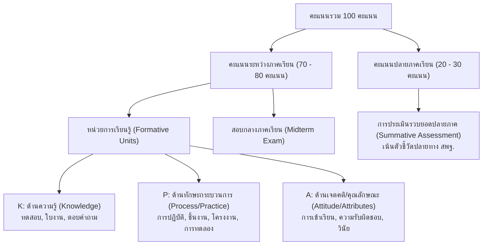

# 📊 ระบบแผนการวัดและประเมินผลการเรียนรู้ (Learning Assessment & Measurement System)
### โรงเรียนพัฒนานิคม สำนักงานเขตพื้นที่การศึกษามัธยมศึกษาลพบุรี (ปีการศึกษา ๒๕๖๙–๒๕๗๑)

> ย้อนกลับ: [[00_หลักสูตรสถานศึกษา]] | [[00_ดัชนีรายวิชาทั้งหมด]] | [[00_สารบัญหลักสูตรแกนกลาง]]

---

## 🧭 วัตถุประสงค์และภาพรวมของระบบ
ระบบแผนการวัดและประเมินผลการเรียนรู้นี้ จัดทำขึ้นโดยถอดรหัสโครงสร้างรายวิชาและแผนการวัดผลจากหลักสูตรกลุ่มสาระการเรียนรู้ทั้ง 8 กลุ่มสาระฯ ของโรงเรียนพัฒนานิคม จำนวน **548 รายวิชา** เพื่อใช้เป็น **ฐานข้อมูลกลาง (Single Source of Truth)** ในการ:
1. **จัดทำแผนการจัดการเรียนรู้ (Lesson Plans):** ดึงตัวชี้วัดระหว่างทาง/ปลายทาง สาระสำคัญ และเวลาเรียนไปใช้สร้างแผนการจัดการเรียนรู้ได้ทันที
2. **ออกแบบแผนการวัดและประเมินผล (Assessment Blueprints):** กำหนดน้ำหนักคะแนนด้านความรู้ (K), กระบวนการ/ทักษะปฏิบัติ (P), และเจตคติ/คุณลักษณะ (A) ได้อย่างแม่นยำตามสัดส่วน 70:30 หรือ 80:20
3. **เชื่อมโยงตัวชี้วัด สพฐ. ๒๕๖๖ ครบวงจร:** เชื่อมโยงตัวชี้วัดระหว่างทางและปลายทางกลับไปยังเอกสารวิเคราะห์ตัวชี้วัดแกนกลาง 2,024 ตัวชี้วัดแบบสองทาง (Bidirectional Wiki-links)

---

## 📈 สรุปจำนวนรายวิชาและโครงสร้างแผนวัดจำแนกตามกลุ่มสาระการเรียนรู้

| ลำดับ | กลุ่มสาระการเรียนรู้ | โฟลเดอร์ในระบบ | จำนวนรายวิชา | สัดส่วนการประเมิน (K:P:A / กลางภาค:ปลายภาค) |
| :---: | :--- | :--- | :---: | :--- |
| 1 | **ภาษาไทย** | [[00_กลุ่มสาระ_ภาษาไทย|01_ภาษาไทย]] | **24** วิชา | ระหว่างภาค 70–80 : ปลายภาค 20–30 |
| 2 | **คณิตศาสตร์** | [[00_กลุ่มสาระ_คณิตศาสตร์|02_คณิตศาสตร์]] | **49** วิชา | ระหว่างภาค 70–80 : ปลายภาค 20–30 |
| 3 | **วิทยาศาสตร์และเทคโนโลยี** | [[00_กลุ่มสาระ_วิทยาศาสตร์และเทคโนโลยี|03_วิทยาศาสตร์และเทคโนโลยี]] | **82** วิชา | ระหว่างภาค 70–80 : ปลายภาค 20–30 |
| 4 | **สังคมศึกษา ศาสนา และวัฒนธรรม** | [[00_กลุ่มสาระ_สังคมศึกษา ศาสนา และวัฒนธรรม|04_สังคมศึกษา]] | **95** วิชา | ระหว่างภาค 70–80 : ปลายภาค 20–30 |
| 5 | **สุขศึกษาและพลศึกษา** | [[00_กลุ่มสาระ_สุขศึกษาและพลศึกษา|05_สุขศึกษาและพลศึกษา]] | **25** วิชา | ระหว่างภาค 70–80 : ปลายภาค 20–30 |
| 6 | **ศิลปะ** | [[00_กลุ่มสาระ_ศิลปะ|06_ศิลปะ]] | **112** วิชา | ระหว่างภาค 70–80 : ปลายภาค 20–30 |
| 7 | **การงานอาชีพ** | [[00_กลุ่มสาระ_การงานอาชีพ|07_การงานอาชีพ]] | **49** วิชา | ระหว่างภาค 70–80 : ปลายภาค 20–30 |
| 8 | **ภาษาต่างประเทศ** | [[00_กลุ่มสาระ_ภาษาต่างประเทศ|08_ภาษาต่างประเทศ]] | **111** วิชา | ระหว่างภาค 70–80 : ปลายภาค 20–30 |
| | **รวมทั้งสิ้น** | | **548** วิชา | **100 คะแนนเต็ม** |

---

## 🎯 โครงสร้างมิติการประเมิน (Assessment Dimensions: K - P - A)

