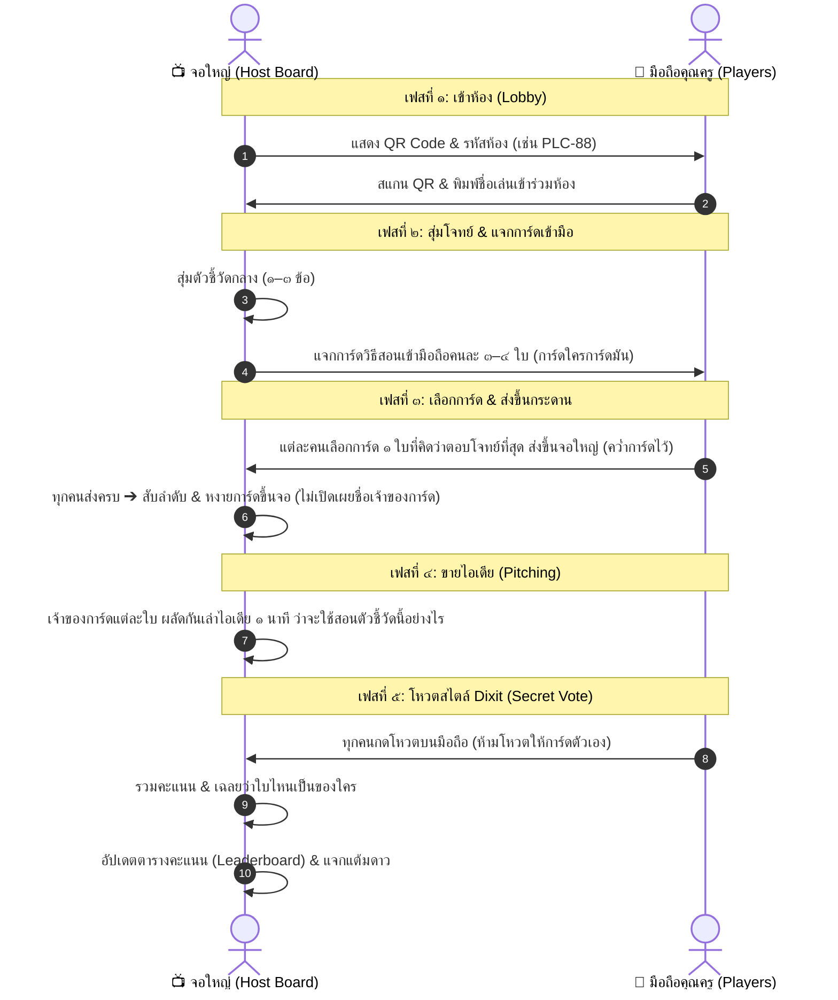

# แผนและสถาปัตยกรรมระบบ: PLC Game "การ์ดใครการ์ดมัน + โหวตสไตล์ Dixit" (มือถือเชื่อมต่อจอใหญ่)

> **เป้าหมาย:** พัฒนาระบบเกม PLC สำหรับครู ให้เล่นร่วมกันในห้องประชุมหรือออนไลน์ โดยใช้จอโปรเจกเตอร์เป็นกระดานกลาง (Host Board) และมือถือของครูแต่ละคนเป็นจอยควบคุมส่วนตัว (Player Controller) ทำงานแบบ Serverless บน GitHub Pages ฟรี 100%

---

## 1. ภาพรวมระบบ (Concept & Device Roles)

* **📺 จอใหญ่ (ทีวี / โปรเจกเตอร์ / โน้ตบุ๊กครูผู้นำวง PLC):**
  * ทำหน้าที่เป็น **Host Board (กระดานกลาง)**
  * แสดง **QR Code & Room Code** ขนาดใหญ่ ให้เพื่อนครูสแกนเข้าห้องด้วยมือถือ
  * แสดง **โจทย์ตัวชี้วัดกลาง** (สุ่มจากหลักสูตรแกนกลาง หรือคลังวิชา รร. พัฒนานิคม)
  * แสดงลำดับขั้นตอนของเกม: รอผู้เล่นส่งการ์ด ➔ หงายการ์ดขึ้นกระดาน ➔ สรุปผลคะแนนโหวต Dixit
* **📱 มือถือของเพื่อนครูแต่ละคน (Smartphone Controller):**
  * สแกน QR Code เข้ามาหน้า `plc-game.html?room=...` หรือ `plc-player.html?room=...` พร้อมใส่ชื่อเล่น (เช่น ครูกานต์, ครูดาว)
  * **"การ์ดใครการ์ดมัน":** มีการ์ดวิธีสอนในมือของตัวเอง ๓–๔ ใบ (ดูได้เฉพาะในจอมือถือตัวเอง)
  * กดเลือกการ์ด ๑ ใบเพื่อ **ส่งขึ้นกระดานกลาง**
  * ในรอบโหวต: มีปุ่มให้กด **โหวตเลือกไอเดียที่ดีที่สุด** (ระบบล็อกไม่ให้โหวตให้การ์ดตัวเอง)

---

## 2. ลูปการเล่นแบบ Dixit (Dixit-Style PLC Game Loop)

---

## 3. กฎการให้คะแนนสไตล์ Dixit (Scoring System)

1. **แต้มจากการโหวต (Popular Vote):**
   * ได้รับ ๑ เสียงโหวต = **+๑ แต้ม**
2. **แต้มโบนัสเจ้าของโจทย์ประจำรอบ (Storyteller / Host Bonus):**
   * ครูผู้นำรอบมอบเหรียญ **"Super Like"** ให้ไอเดียที่ช่วยแก้ปัญหาห้องเรียนได้ตรงจุดที่สุด = **+๒ แต้ม**
3. **แต้มพื้นฐานของการ์ด (Card Star Points):**
   * หากไอเดียที่เสนอผ่านการโหวต ได้รับแต้มตามระดับดาวของการ์ดวิธีสอนนั้นด้วย (`⭐ +2`, `⭐⭐ +3`, `⭐⭐⭐ +4`)

---

## 4. สถาปัตยกรรมการเชื่อมต่อ (Serverless & Free บน GitHub Pages)

เพื่อให้ระบบทำงานได้ **100% บน GitHub Pages โดยไม่ต้องเช่า Server**:
* **การเชื่อมต่อแบบ Real-time:**
  * ใช้ **MQTT over Secure WebSockets (HiveMQ / EMQX Public Broker WSS)** หรือ **WebRTC DataChannel ผ่าน PeerJS**:
    * **ปลอดภัย & ฟรี 100%**
    * **ไม่ต้องสมัครบัญชี ไม่ต้องกรอก API Key**
    * เชื่อมต่อเรียลไทม์ระหว่างจอโปรเจกเตอร์กับมือถือได้ทันที ไม่ต้องมี backend server
* **การสร้าง QR Code:**
  * ใช้ไลบรารี `qrcode.min.js` สร้าง QR Code คมชัดบนจอโปรเจกเตอร์ สแกนแล้วเปิดหน้าเว็บมือถือพร้อมใส่ Room Code ให้อัตโนมัติ

---

## 5. แผนการดำเนินงาน (Implementation Steps)

1. **โครงสร้างไฟล์:**
   * แยกหน้าจอระหว่าง Host Board (`plc-game.html` จอใหญ่) และ Controller (`plc-player.html` จอมือถือ) หรือรวมเป็น responsive parameter `?room=...`
2. **หน้าจอ Host Board (จอโปรเจกเตอร์):**
   * ปุ่มเปิดห้อง Dixit Mode
   * หน้า Lobby แสดง QR Code + รายชื่อเพื่อนที่สแกนเข้ามา
   * หน้า Deal Cards & รอส่งการ์ด
   * หน้าหงายการ์ดและผลโหวต
3. **หน้าจอมือถือ (Player Controller):**
   * Mobile-first UI
   * ระบบดูการ์ดในมือของตัวเอง
   * ปุ่มกดยืนยันการส่งการ์ดขึ้นจอ
   * หน้าจอกดโหวตแบบลับ
