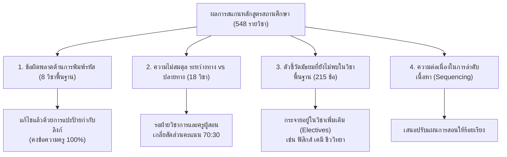

# 📋 ทะเบียนบันทึกข้อสังเกต ข้อผิดพลาด และความไม่สมดุลของหลักสูตรสถานศึกษา
**โรงเรียนพัฒนานิคม สังกัดสำนักงานเขตพื้นที่การศึกษามัธยมศึกษาลพบุรี**  
*จัดทำโดย: ระบบตรวจสอบความสอดคล้องหลักสูตร CurriculumMD & Thailand Open Curriculum Platform*  
*วันที่บันทึก:* 14 ตุลาคม 2569  

---

> [!IMPORTANT]
> **หลักการสำคัญในการบันทึก:**
> ทะเบียนฉบับนี้จัดทำขึ้นเพื่อ **บันทึกข้อเท็จจริงของข้อมูล (Data Provenance)** ที่ตรวจพบในเอกสารหลักสูตรสถานศึกษา (ไฟล์ Word ต้นฉบับ) โดย **ไม่มีการปรับแก้หรือดัดแปลงเนื้อหาหลักสูตรของคุณครูโดยพลการ** ข้อความเดิมของคุณครูทุกตัวอักษรยังคงได้รับการเก็บรักษาไว้ครบถ้วนในไฟล์วิชาจริง ข้อมูลในเอกสารนี้มีไว้เพื่อให้ฝ่ายวิชาการและคุณครูผู้สอนใช้เป็นข้อมูลอ้างอิงในการปรับปรุงหลักสูตรในรอบปีการศึกษาถัดไป

---

## 📌 สรุปหมวดหมู่ปัญหาที่ตรวจพบ

---

## 🔍 หมวดที่ 1: รายการข้อผิดพลาดด้านการพิมพ์และรหัสตัวชี้วัด (Code & Syntax Errors)
*ตรวจพบทั้งหมด 8 รายวิชาพื้นฐาน (ได้รับการสถาปนาแท็กเชื่อมโยงเรียบร้อยแล้ว โดยคงข้อความเดิมไว้ 100%)*

| ลำดับ | รหัส - ชื่อวิชา | ระดับชั้น | จุดที่พบในเอกสารเดิมของคุณครู | ข้อเท็จจริงตามมาตรฐาน สพฐ. | การดำเนินการของระบบเพื่อแก้ปัญหา Graph |
| :---: | :--- | :---: | :--- | :--- | :--- |
| 1 | **ท21102 ภาษาไทย 2** | ม.1 (เทอม 2) | พิมพ์ตกจุด เช่น `ม 1/1`, `ม 1/6`, `ม 1/2`, `ม 1/5` (เว้นวรรคแทนจุด) ในทั้ง 2 หน่วย | มาตรฐาน สพฐ. เขียนว่า `ม.1/1`, `ม.1/6` ฯลฯ | คงข้อความเดิมของครูไว้ทั้งหมด และเติม `🔹 ตัวชี้วัด สพฐ.: [[ท 1.1 ม.1-1\|ท 1.1 ม.1/1]]...` ต่อท้าย |
| 2 | **ท31102 ภาษาไทย 2** | ม.4 (เทอม 2) | พิมพ์ตกจุด เช่น `ม 4-6/2`, `ม 4-6/1` ในทั้ง 4 หน่วยการเรียนรู้ | มาตรฐาน สพฐ. เขียนว่า `ม.4-6/2`, `ม.4-6/1` | คงข้อความเดิมของครูไว้ทั้งหมด และเติม `🔹 ตัวชี้วัด สพฐ.: [[ท 4.1 ม.4-6-2\|ท 4.1 ม.4-6/2]]...` ต่อท้าย |
| 3 | **ส32102 ประวัติศาสตร์ 3** | ม.5 (เทอม 1) | พิมพ์ข้อความ *"สร้างองค์ความรู้ใหม่ฯ ด้วยวิธีการทางประวัติศาสตร์"* แต่ระบุรหัสหัวตารางเป็น `ส 4.2 ม 4-6/2` (หน่วยที่ 1, 2, 3, 5) | ข้อความดังกล่าวตรงกับมาตรฐาน `ส 4.1 ม.4-6/2` (วิธีการทางประวัติศาสตร์) ส่วน `ส 4.2` คือสาระพัฒนาการมนุษยชาติ | คงข้อความเดิมของครูไว้ 100% และเติม `🔹 ตัวชี้วัด สพฐ. ที่สอดคล้อง: [[ส 4.1 ม.4-6-2\|ส 4.1 ม.4-6/2]]` พร้อมใส่หมายเหตุประกอบ |
| 4 | **ว30102 วิทยาศาสตร์กายภาพเคมี** | ม.4 (เทอม 2) | ระบุรหัสแบบรวมช่วง เช่น `ว 2.1 ม. 5/1-6`, `ว 2.1 ม. 5/8-10`, `ว 2.1 ม. 5/14-18` | สพฐ. กำหนดตัวชี้วัดสาระเคมีกายภาพเป็นรายข้อ (รวม 25 ข้อ) | คงข้อความ `1-6` ของครูไว้ และเติมแท็กลิงก์รายข้อ `[[ว 2.1 ม.5-1]]` ถึง `[[ว 2.1 ม.5-25]]` ในแต่ละหน่วย |
| 5 | **พ21102 พลศึกษา 1 (ฟุตซอล)** | ม.1 (เทอม 1) | ระบุรหัสภายใน เช่น `พ 3.5 ม1/4` (สมรรถภาพทางกาย) และ `พ 3.3`, `พ 3.4` (ทักษะฟุตซอล) ซึ่งไม่มีในเล่ม สพฐ. | สาระ สพฐ. ม.1 มี `พ 3.1` (ทักษะกีฬา), `พ 3.2` (กติกา/ทีม) และ `พ 4.1 ม.1/4` (สมรรถภาพทางกาย) | คงข้อความบรรยายทักษะฟุตซอลของครูไว้ทั้งหมด 100% แล้วเติมแท็กเทียบเคียงมาตรฐานจริง `[[พ 3.1 ม.1-1]]`, `[[พ 4.1 ม.1-4]]` |
| 6 | **ง21102 การงานอาชีพ 1** | ม.1 (เทอม 1) | หน่วยที่ 2 และ 3 บรรยายมาตรฐาน `ง 2.1` และระบุตัวชี้วัด `ม.1/1`, `ม.1/2`, `ม.1/3` แต่ไม่มีลิงก์ | มาตรฐาน `ง 2.1 ม.1/1 - ม.1/3` | คงข้อความเดิมของครูไว้ 100% และเติม `🔹 ตัวชี้วัด สพฐ.: [[ง 2.1 ม.1-1]]...` ต่อท้าย |
| 7 | **ง22101 การงานอาชีพ 3** | ม.2 (เทอม 1) | หน่วยที่ 1–4 บรรยายตัวชี้วัด `ม.2/1 - ม.2/3` ครบทั้ง 4 หน่วย แต่ไม่มีลิงก์ | มาตรฐาน `ง 1.1 ม.2/1-3` และ `ง 2.1 ม.2/1-3` | คงข้อความเดิมของครูไว้ 100% และเติมแท็กลิงก์ `[[ง 1.1 ม.2-1]]` และ `[[ง 2.1 ม.2-1]]` ต่อท้าย |
| 8 | **ง22102 การงานอาชีพ 4** | ม.2 (เทอม 2) | หน่วยที่ 1 และ 2 บรรยายตัวชี้วัด `ม.2/1` และ `ม.2/2` แต่ไม่มีลิงก์ | มาตรฐาน `ง 1.1 ม.2/1` และ `ง 1.1 ม.2/2` | คงข้อความเดิมของครูไว้ 100% และเติมแท็กลิงก์ `[[ง 1.1 ม.2-1]]` และ `[[ง 1.1 ม.2-2]]` ต่อท้าย |

---

## ⚖️ หมวดที่ 2: รายการความไม่สมดุลของตัวชี้วัด ระหว่างทาง vs ปลายทาง (18 วิชา)
*ตามแนวทางการวัดและประเมินผลการเรียนรู้ของ สพฐ. ปีการศึกษา ๒๕๖๖ กำหนดให้:*
* **ตัวชี้วัดระหว่างทาง (Formative):** ใช้สำหรับจัดการเรียนรู้และเก็บคะแนนระหว่างเรียน (สัดส่วนประมาณ 70–80%)
* **ตัวชี้วัดปลายทาง (Summative):** ใช้สำหรับประเมินผลลัพธ์รวบยอดปลายภาค/ปลายปี (สัดส่วนประมาณ 20–30%)

### 1. กลุ่มวิชาที่มีแต่ "ปลายทาง" (มีตัวชี้วัดระหว่างทาง 0 ข้อ) — รวม 13 วิชา
> ⚠️ **ความเสี่ยงทางวิชาการ:** หากไม่มีตัวชี้วัดระหว่างทาง ครูจะไม่มีเกณฑ์รูบริก (Rubrics) อ้างอิงตามมาตรฐาน สพฐ. ในการเก็บคะแนนระหว่างภาค 70%

1. **`ค21102 คณิตศาสตร์ 2` (ม.1):** ปลายทาง 5 ข้อ | ระหว่างทาง 0 ข้อ
2. **`ค22102 คณิตศาสตร์ 4` (ม.2):** ปลายทาง 5 ข้อ | ระหว่างทาง 0 ข้อ
3. **`ค23101 คณิตศาสตร์ 5` (ม.3):** ปลายทาง 6 ข้อ | ระหว่างทาง 0 ข้อ
4. **`ค23102 คณิตศาสตร์ 6` (ม.3):** ปลายทาง 5 ข้อ | ระหว่างทาง 0 ข้อ
5. **`ค31101 คณิตศาสตร์ 1` (ม.4):** ปลายทาง 1 ข้อ | ระหว่างทาง 0 ข้อ
6. **`ค31102 คณิตศาสตร์ 2` (ม.4):** ปลายทาง 2 ข้อ | ระหว่างทาง 0 ข้อ
7. **`ค32102 คณิตศาสตร์ 4` (ม.5):** ปลายทาง 1 ข้อ | ระหว่างทาง 0 ข้อ
8. **`ค33102 คณิตศาสตร์ 6` (ม.6):** ปลายทาง 1 ข้อ | ระหว่างทาง 0 ข้อ
9. **`ง22102 การงานอาชีพ 4` (ม.2):** ปลายทาง 2 ข้อ | ระหว่างทาง 0 ข้อ
10. **`ว30106 วิทยาการคำนวณ` (ม.4):** ปลายทาง 1 ข้อ | ระหว่างทาง 0 ข้อ
11. **`ส31103 สังคมศึกษาฯ 2` (ม.4):** ปลายทาง 2 ข้อ | ระหว่างทาง 0 ข้อ
12. **`ส32104 ประวัติศาสตร์ 4` (ม.5):** ปลายทาง 2 ข้อ | ระหว่างทาง 0 ข้อ
13. **`พ22101 สุขศึกษาและพลศึกษา 3` (ม.2):** ปลายทาง 1 ข้อ | ระหว่างทาง 0 ข้อ

### 2. กลุ่มวิชาที่มีแต่ "ระหว่างทาง" (มีตัวชี้วัดปลายทาง 0 ข้อ) — รวม 5 วิชา
> ⚠️ **ความเสี่ยงทางวิชาการ:** หากไม่มีตัวชี้วัดปลายทาง ครูจะไม่มีเป้าหมายรวบยอดสำหรับนำไปออกข้อสอบปลายภาค (Final Examination 30%)

1. **`ส31104 ประวัติศาสตร์ 2` (ม.4):** ระหว่างทาง 2 ข้อ | ปลายทาง 0 ข้อ
2. **`ท31101 ภาษาไทย 1` (ม.4):** ระหว่างทาง 3 ข้อ | ปลายทาง 0 ข้อ
3. **`ค32101 คณิตศาสตร์ 3` (ม.5):** ระหว่างทาง 1 ข้อ | ปลายทาง 0 ข้อ
4. **`ง32102 การงานอาชีพ 4` (ม.5):** ระหว่างทาง 2 ข้อ | ปลายทาง 0 ข้อ
5. **`พ23102 พลศึกษา 5` (ม.3):** ระหว่างทาง 1 ข้อ | ปลายทาง 0 ข้อ

---

## 🌐 หมวดที่ 3: สถิติตัวชี้วัดระดับมัธยมที่ยังไม่ปรากฏในวิชาพื้นฐาน (215 ข้อ)
จากการเปรียบเทียบกับฐานข้อมูลแกนกลางของ สพฐ. (ระดับ ม.1–ม.6 ทั้งหมด 995 ข้อ) พบว่าวิชาพื้นฐานครอบคลุมแล้ว **780 ข้อ (78.4%)** และมีตัวชี้วัดที่ยังไม่พบในวิชาพื้นฐาน **215 ข้อ (21.6%)** โดยจำแนกรายกลุ่มสาระได้ดังนี้:

| กลุ่มสาระการเรียนรู้ | มัธยมทั้งหมด | พบในวิชาพื้นฐาน | ยังไม่พบในวิชาพื้นฐาน | สาเหตุหลัก |
| :--- | :---: | :---: | :---: | :--- |
| **01_ภาษาไทย** | 71 | 71 | **0 ข้อ (0.0%)** | ✅ สอนครบถ้วน 100% ในวิชาพื้นฐาน |
| **02_คณิตศาสตร์** | 68 | 66 | **2 ข้อ (2.9%)** | ค 2.1 ม.2/2 (ปริมาตรทรงกระบอก), ค 1.2 ม.5/1 |
| **03_วิทยาศาสตร์และเทคโนโลยี** | 227 | 148 | **79 ข้อ (34.8%)** | เป็นเนื้อหาฟิสิกส์ เคมี ชีววิทยา โลกและอวกาศ ม.ปลาย ซึ่งจัดสอนใน **วิชาเพิ่มเติม** |
| **04_สังคมศึกษาฯ** | 200 | 179 | **21 ข้อ (10.5%)** | สาระภูมิศาสตร์และศาสนาบางข้อถูกจัดสอนในวิชาเพิ่มเติม |
| **05_สุขศึกษาและพลศึกษา** | 108 | 76 | **32 ข้อ (29.6%)** | ชนิดกีฬาทางเลือก (เช่น ยืดหยุ่น แบดมินตัน บาสเกตบอล) ซึ่งโรงเรียนเลือกสอนเฉพาะฟุตซอล |
| **06_ศิลปะ** | 144 | 88 | **56 ข้อ (38.9%)** | ดนตรีสากล นาฏศิลป์สากล และทัศนศิลป์เฉพาะทาง ซึ่งจัดสอนในวิชาเพิ่มเติม |
| **07_การงานอาชีพ** | 24 | 15 | **9 ข้อ (37.5%)** | งานเกษตร ช่าง ประดิษฐ์ ธุรกิจ ซึ่งจัดสอนในวิชาเพิ่มเติม |
| **08_ภาษาต่างประเทศ** | 153 | 137 | **16 ข้อ (10.5%)** | ตัวชี้วัดภาษาอังกฤษระดับสูงและภาษาที่ 2 (ฝรั่งเศส จีน ญี่ปุ่น) ในวิชาเพิ่มเติม |
| **รวมทั้งสิ้น** | **995** | **780** | **215 ข้อ (21.6%)** | — |

---

## 🧭 หมวดที่ 4: ข้อเสนอแนะเชิงยุทธศาสตร์สำหรับฝ่ายวิชาการโรงเรียนพัฒนานิคม
1. **จัดทำ Curriculum Matrix ร่วมกันระหว่างวิชาพื้นฐานและวิชาเพิ่มเติม:**  
   นำตัวชี้วัดที่ยังไม่พบ 215 ข้อ (โดยเฉพาะกลุ่มวิทย์-คณิต-ศิลปะ ม.ปลาย) ไปตรวจสอบเทียบเคียงกับ "ผลการเรียนรู้" ของ 446 รายวิชาเพิ่มเติม เพื่อให้ทำรายงานต่อสำนักงานเขตพื้นที่ฯ ได้ว่าโรงเรียนสอนครอบคลุมครบ 100%
2. **เกลี่ยสัดส่วนตัวชี้วัดระหว่างทาง : ปลายทาง:**  
   กลุ่มสาระคณิตศาสตร์และสุขศึกษา ควรพิจารณาแบ่งตัวชี้วัดระหว่างทางเข้ามาในตารางโครงสร้างรายวิชา เพื่อให้คุณครูมีเกณฑ์เก็บคะแนนระหว่างเรียน 70% ได้ถูกต้องตามระเบียบ สพฐ.
3. **การใช้งานเอกสารฉบับนี้:**  
   ทะเบียนบันทึกข้อบกพร่องฉบับนี้พร้อมใช้งานสำหรับการประชุมปรับปรุงหลักสูตรสถานศึกษา พ.ศ. 2570–2572 ต่อไป
